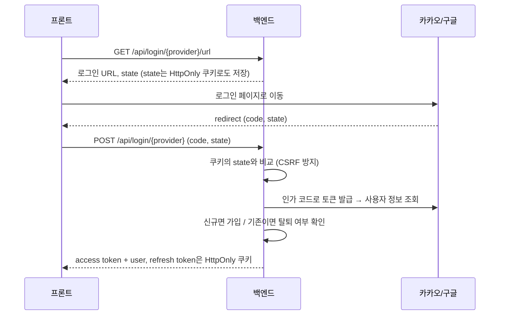

# 🍽️ 둔둔 (dundun)

**사진 한 장에서 되살아나는, 우리 둘의 맛집 기억**

연인과 함께 다닌 맛집의 기록을 남기는 **커플 맛집 다이어리** 백엔드 서버

---

## 📌 개요

### 기획 배경

맛집 투어를 다니며 음식 사진을 많이 찍지만, 시간이 지나 사진만 보면 **"여기가 어디였지?"** 하고 기억나지 않는 경우가 많습니다.
이 불편함을 직접 겪은 경험에서 출발해, 사진에 담긴 정보로 방문 장소를 되짚어 주고 그날의 추억까지 함께 남길 수 있는 서비스를 만들고 있습니다.

### 설계 원칙

- 🎯 도메인 범위를 **"개인 기록 + 2인 공유"** 로 한정합니다. (SNS, 추천 알고리즘, 결제 등은 제외)
- 💸 배포·운영 비용을 최소화합니다.
- 📜 카카오 정책에 따라 **카카오 플레이스 검색 결과는 DB에 저장하지 않습니다.**
- 📦 중요한 파라미터는 쿼리스트링이 아닌 **요청 바디**로 전달합니다.

---

## ✨ 주요 기능

| 기능                       | 설명                                               | 상태    |
|----------------------------|----------------------------------------------------|---------|
| 🔐 인증/인가               | 소셜 로그인, JWT, 토큰 재발급, 로그아웃            | ✅ 완료 |
| ⚙️ 공통 인프라             | 전역 예외 처리, DB 세팅, 로깅                      | ✅ 완료 |
| 👫 커플 연결               | 두 사람이 하나의 공간을 공유                       | 🚧 예정 |
| 📷 사진 업로드 & EXIF 추출 | 음식 사진의 촬영 시각·위치 정보 추출               | 🚧 예정 |
| 📍 방문 장소 제안          | 카카오맵 API로 "이 장소를 방문하셨나요?" 후보 제안 | 🚧 예정 |
| 📝 추억 기록               | 방문 장소별 메모와 그날의 분위기 기록              | 🚧 예정 |

### 🔐 인증/인가

카카오·구글 **소셜 로그인**과 **JWT** 기반의 무상태(STATELESS) 인증입니다.
access token은 응답 body로, refresh token은 **HttpOnly 쿠키**로 전달합니다.

**소셜 로그인:** 카카오와 구글 모두 인가 코드 방식으로 구현했습니다. 백엔드가 로그인 URL과 `state`를 발급하면서 `state`를 HttpOnly 쿠키로도 저장해 두고, 로그인 요청 시 쿠키 값과 비교해
CSRF를 방지합니다. 토큰 교환에 쓰는 redirect URI는 클라이언트 입력이 아닌 서버 설정값만 사용합니다. 신규 사용자는 소셜 계정 정보로 자동 가입되며 닉네임은 중복을 검사한 랜덤 값으로 생성하고, 탈퇴한
사용자는 같은 계정으로 다시 로그인할 수 없습니다.

**토큰 발급과 저장:** access token은 15분, refresh token은 2일 동안 유효하며, `type` 클레임으로 용도를 구분하고 서명과 issuer를 검증합니다. access token은 응답
body로 내려주고, refresh token은 HttpOnly 쿠키로 전달합니다. 쿠키는 운영 환경에서 `Secure` + `SameSite=None`, 로컬에서는 `Lax`로 설정합니다. DB에는 refresh
token 원본이 아닌 **SHA-256 해시만** 저장해, DB가 유출되어도 토큰을 바로 쓸 수 없게 했습니다.

**토큰 재발급:** 재발급할 때마다 access token과 refresh token을 모두 새로 발급하는 **Refresh Token Rotation** 방식입니다. 쿠키로 받은 refresh token의 해시가
DB 값과 다르면 탈취된 토큰으로 간주해 저장된 토큰을 폐기하고 쿠키를 만료시킵니다. 이 폐기는 별도 트랜잭션으로 분리해, 예외가 발생해도 롤백되지 않고 DB에 반영됩니다.

**로그아웃:** access token이 만료된 상태에서도 로그아웃할 수 있도록 인증 제외 경로로 두고, refresh token 쿠키로 사용자를 식별합니다. 사용자 식별이나 DB 처리 성공 여부와 관계없이 쿠키는
항상 만료시킵니다.

**운영 안전장치:** 요청 body는 로그에 남기지 않습니다. 카카오·구글 등 외부 API 호출에는 connect/read 타임아웃을 적용했고, 호출이 실패하면 도메인 예외로 변환해 일관된 에러 응답을 내려줍니다.

---

## 🛠️ 기술 스택

| 구분          | 기술                                                     |
|---------------|----------------------------------------------------------|
| Language      | Kotlin 2.3                                               |
| Framework     | Spring Boot 4.1 (WebMVC, Data JPA, Security, Validation) |
| Database      | MySQL                                                    |
| Auth          | jjwt                                                     |
| 외부 API 연동 | Spring HTTP Interface (RestClient)                       |
| Logging       | kotlin-logging                                           |

---

## 🗂️ 테이블 목록

### `user`

| 컬럼                                     | 설명                               |
|------------------------------------------|------------------------------------|
| `user_id` (PK)                           | 사용자 ID                          |
| `status`                                 | `ACTIVE` / `DELETED`               |
| `role`                                   | `USER` / `ADMIN`                   |
| `oauth_id`, `oauth_provider`             | 소셜 계정 식별자 (복합 UNIQUE)     |
| `email`                                  | 이메일                             |
| `nickname`                               | 닉네임 (UNIQUE, 가입 시 랜덤 생성) |
| `file_id`                                | 프로필 이미지                      |
| `refresh_token`                          | refresh token의 SHA-256 해시       |
| `created_at`, `updated_at`, `deleted_at` | 생성 / 수정 / 탈퇴 시각            |

---

## 🔌 API 목록

| Method | Path                    | 인증                  | 설명                            |
|--------|-------------------------|-----------------------|---------------------------------|
| GET    | `/api/login/kakao/url`  | ❌                    | 카카오 로그인 URL 및 state 발급 |
| POST   | `/api/login/kakao`      | ❌                    | 카카오 로그인                   |
| GET    | `/api/login/google/url` | ❌                    | 구글 로그인 URL 및 state 발급   |
| POST   | `/api/login/google`     | ❌                    | 구글 로그인                     |
| POST   | `/api/token/reissue`    | 🍪 refresh token 쿠키 | access/refresh token 재발급     |
| POST   | `/api/logout`           | 🍪 refresh token 쿠키 | 로그아웃                        |

- **에러 응답**: `{ errCode, errName, errMsg, time }`
- 인증이 필요한 API는 `Authorization: Bearer {accessToken}` 헤더 사용